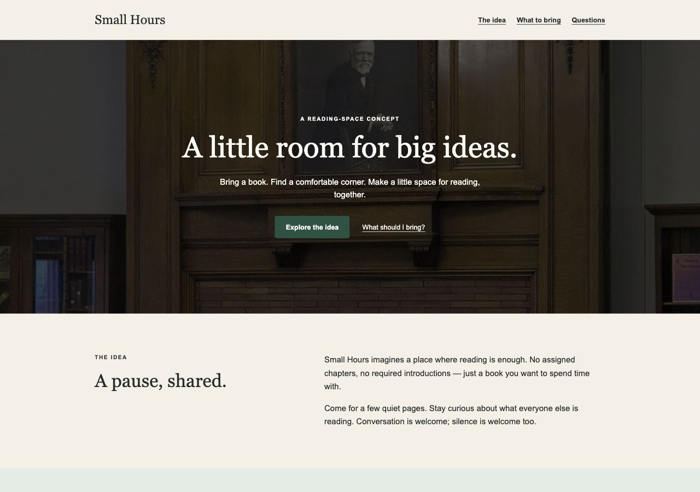

# Pick Your Design

Choose a website's visual direction from real references, then turn your decisions into an executable `design-spec.md`.

[简体中文](README.zh-CN.md)

## See the result

The [Small Hours reading-room example](examples/reading-room/README.md) connects **real website references → a choice of large photography with centered copy → a detailed specification → a working static page**. The brief is fictional; a person made the visual choice during validation. Later color changes are explicitly labeled test inputs.



Read the [reference decisions](examples/reading-room/references.md), [complete specification](examples/reading-room/design-spec.md), and [page source](examples/reading-room/site/index.html). The photograph has a recorded CC0 source; third-party website screenshots are not redistributed.

## Install

You need **Node.js 22.20.0 or newer**, npm/npx, Git, and a client that can load skills. Run this in the project where you want to use the skill:

```sh
npx skills add CATO2DL/pick-your-design --skill pick-your-design -a codex
```

This is a project installation through the existing [skills CLI](https://github.com/vercel-labs/skills), not a new installer. Review its installation summary. Check it with `npx skills list -a codex`. See [installation options](docs/installation.md) for Claude Code, global scope, discovery, and manual installation.

## Start your first project

Open that project in Codex and paste:

```text
Use $pick-your-design for a small reading-space website. I cannot describe
my preferred style yet: show me 6–7 real website references with visible
images, stable IDs, and sources, then wait for my choice. Use what I have
already told you and ask only what affects the next step. Refine the copy,
page structure, mobile layout, and interactions. Save a complete
design-spec.md in this project. Deliver Markdown only; do not generate
images, build, or publish the website.
```

Have your own images, or an existing spec? Use the [three ready-to-copy prompts](docs/first-use.md).

## What happens next

1. You see actual reference images, each with an ID and source. Reply with an ID, a combination such as “B's layout + E's colors,” or just the part you like.
2. You can reject every option, return to an earlier reference, add your own, or skip further rounds. Selecting an image does not approve every attribute in it.
3. Later rounds normally contain 4–6 references and focus on one or two unresolved choices. The agent then fills in content, functionality, and concrete design parameters.
4. You receive a real `design-spec.md`: full copy, layout, colors, typography, mobile behavior, assets, assumptions, revision history, execution instructions, and acceptance criteria. It can be handed to another AI without chat history.

A Markdown-only request stops there. With authorization, the host can continue to create one design. Publishing requires authorization too. Posters, images, brands, and slides remain supported workflows; the website example is the first validated case.

## Capabilities and validation

This repository provides instructions, not search, screenshot, image-display, or creation services. Installing a skill does not add those tools. Exploration uses no image generation by default; a whole-task ban on generation also applies to final creation. Search and model usage may cost money.

| Environment | Verified level on 2026-10-26 |
| --- | --- |
| Current Codex desktop session | Complete website workflow exercised with real browsing, visible images, human visual choice, file output, and local page preview. Skill instructions were loaded explicitly from files. |
| Codex CLI 0.163.0-alpha.11 | Installation and enabled repository-skill discovery verified; no separate model workflow run. |
| Claude Code target | Installation/list/removal verified through skills CLI 1.7.4. Claude Code itself is absent here: loading and end-to-end use are unverified. |
| Other clients | Unverified. Installer compatibility is not a workflow guarantee. |

The host needs search/browsing, image inspection **and** user-visible images, chat feedback, and Markdown file writing. Continuing to a website also needs file creation and a browser preview. [Capability details, versions, and evidence](docs/validation.md).

If search is unavailable, supply your own reference images. If image display fails, use the host's supported image viewer or a verified local reference board; reply with IDs in chat. If images still cannot be shown, the agent must say so and cannot claim visual selection is complete. [Fallbacks](docs/first-use.md#when-tools-are-missing).

## Update, uninstall, and questions

From the same project, update only this skill:

```sh
npx skills update pick-your-design -p -y
```

Back up any edits to the installed skill before updating. To remove only its Codex installation:

```sh
npx skills remove pick-your-design -a codex -y
```

**Skill not appearing?** Verify the project directory and installation listing; reopen the client if needed. **Installed but no images?** Installation does not supply image tools. **Only want the spec?** Say “Markdown only.” **Can I reuse a reference image?** Check that image's license separately. More in [installation and troubleshooting](docs/installation.md).

## Examples, license, and feedback

- [Reproduce the first website case](examples/reading-room/README.md)
- [First-use prompts and fallback paths](docs/first-use.md)
- [Workflow](SKILL.md) and [specification template](references/design-spec-template.md)
- [Validation report](docs/validation.md)
- [MIT license](LICENSE) for original files; [asset licensing](examples/reading-room/site/assets/README.md) for the example photograph
- [Report an issue](https://github.com/CATO2DL/pick-your-design/issues)

If this workflow is useful to you, a GitHub Star helps others find it.
